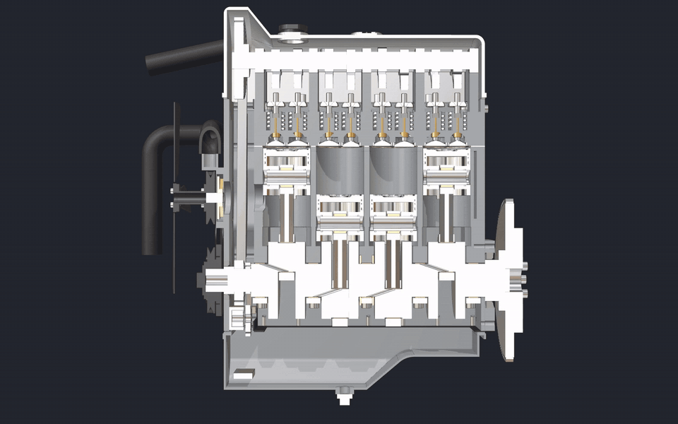

# Loböle

[](https://github.com/eliasaronson/Designer/actions/workflows/ci.yml)

Project to build an open-source parametric 3D CAD application using Vulkan,
ImGui and OpenCASCADE — working the way commercial parametric CAD applications
do, with transformation checkpoints, global variables, git-based versioning,
and an interface designed so that LLM assistants can use the same commands as
human users.

Scripting happens outside the process: the app serves a JSON-RPC interface,
and a generated Python SDK (the `lobole` package, `python/lobole/`), an MCP server for agents
and plain scripts all drive it (see
[docs/scripting/README.md](docs/scripting/README.md)). An optional terminal
panel runs a shell or an agent inside the app window, already pointed at that
instance ([docs/ui/terminal.md](docs/ui/terminal.md)). There is no Python
interpreter embedded in the app.

See [docs/README.md](docs/README.md) for how each part of the program works, and
[docs/roadmap.md](docs/roadmap.md) for what is not built yet.

## Gallery

Every model here is built by a generator — an ordinary Python program driving
the same API the GUI and an LLM assistant use. The stills are Loböle's own
path tracer; the animation is its motion-video export. See
[generators/README.md](generators/README.md) for all of them.

| | |
|:---:|:---:|
| [](generators/om615) | [](generators/om615) |
| **OM615 diesel** — every part down to the bearing shells, with its Bosch injection pump chained to the crank and timed | **Two revolutions, in section** — one crank drives the pistons and the valve train, clash-checked all the way round |
| [](generators/bike) | [](generators/fpv_drone) |
| **Bicycle** — modelled from photographs: frame, wheels with laced spokes, chain drive | **5-inch FPV quadcopter** — 91 occurrences, fitted fasteners, FEM on the arms |

## Installing

Each release (the GitHub releases page) carries:

- **Nix / NixOS:** `nix run github:eliasaronson/Designer` — the full app,
  GUI included.
- **Windows:** a portable zip and an installer. Built on Linux and tested
  under Wine only, and not signed, so SmartScreen warns; Netgen meshing (and
  so FEM) is missing there.
- **Linux, headless:** an AppImage that runs the document engine and its
  JSON-RPC interface without a window (`--headless --remote PORT`). It needs
  FUSE and unprivileged user namespaces, which Ubuntu 23.10+ restricts
  ([the headless AppImage](docs/packaging/README.md#the-headless-appimage)).
  For the GUI on a non-Nix distribution, build from source (below).
- **Container:** `ghcr.io/eliasaronson/lobole-headless`, the same headless
  engine ([Container](#container-headless)).
- **Python:** `pip install lobole` (or `uv tool install lobole`) — the
  client, the SDK and the MCP server (`lobole-mcp`), which drive a running
  app ([docs/scripting/README.md](docs/scripting/README.md)).

[docs/packaging/README.md](docs/packaging/README.md) says how each is built
and what a release checks before it publishes one.

## Requirements

Loböle builds on any Linux with the libraries below; two paths are verified
continuously, and the rest is a matter of your distribution's package names.

**Ubuntu 24.04** — this exact list is what CI installs on every push, so it
cannot rot:

```
sudo apt install git cmake ninja-build build-essential python3 \
    libvulkan-dev glslc libglfw3-dev libglm-dev \
    libspdlog-dev libgtk-3-dev nlohmann-json3-dev libeigen3-dev libboost-dev \
    libocct-data-exchange-dev libocct-modeling-algorithms-dev libocct-modeling-data-dev \
    libocct-foundation-dev libocct-ocaf-dev libocct-visualization-dev \
    libvterm-dev
```

(`libvterm-dev` is optional — without it the app builds without the terminal
panel, and the preference for it disappears.)

### Optional features, and how to leave them out

`cmake` prints what it compiled in, so nothing is inferred:

```
Loböle 0.1.0 — optional features
  [x] CAM (milling, G-code)        deps/clipper2 (vendored, Boost)  -DENABLE_CAM=OFF
  [x] Terminal panel               libvterm (system)  -DENABLE_TERMINAL=OFF
  [x] FEM solver                   Eigen (system)
  ...
```

Everything marked with a switch can be turned off at configure time, and the
feature then does not exist: no sources compiled, no dependency looked for, no
tests, no RPCs in `describe`, no preference in the window. `cmake -B build
-DENABLE_CAM=OFF -DENABLE_TERMINAL=OFF` builds and passes its suite, which is
the full suite minus exactly those features' tests.

The two dependencies those flags govern are deliberately small: **Clipper2**
is vendored (three `.cpp` files, Boost licence, nothing transitive) and
**libvterm** is 167 KB with no dependencies of its own.

**NixOS / Nix** — `shell.nix` pins every dependency including the optional
ones: `nix-shell` in the repo root, and nothing to install. (The Vulkan ICD
comes from your system config — `hardware.graphics.enable = true` plus your
GPU driver module — not from the shell.)

**Flatpak** — distribution-independent, and the way to get a GPU-accelerated
build without matching system libraries: `tools/flatpak-build.sh`
(manifest in `packaging/flatpak/`).

**Other distributions** — there is no curated package list, but the
requirements are ordinary: a C++23 compiler, CMake ≥ 3.14, Vulkan headers +
loader + `glslc`, GLFW, GLM, spdlog, nlohmann-json, Eigen 3.3+, Boost headers,
GTK 3 (file dialogs) and OpenCASCADE 7.6+ (foundation, modeling data,
modeling algorithms, data exchange, OCAF, visualization). The Ubuntu list
above is the reference for *what*; your package manager decides the names.

**Windows** cross-compiles from Linux (see `packaging/windows/`). **macOS** is
not supported — no one has built it there.

### Optional dependencies, and what you lose without them

CMake finds these if present and prints a warning if not; the app builds and
runs either way.

| Missing | Effect |
| --- | --- |
| **Netgen** | No FEM meshing — the simulation workspace opens and `run_study` errors. The suites drop what cannot be checked and say so: the two `sim` GUI cases that assert on solve numbers go unregistered (named in a startup warning), as do the Catch2 FEM ones. Not in Ubuntu's repos; `shell.nix` and the Flatpak provide it. |
| **Spectra** | No modal analysis (natural frequencies). Static stress still works. |
| **Dear ImGui Test Engine** | Deliberate, via `-DENABLE_TEST_ENGINE=OFF`; see below. |

So an apt-based build gives you the whole CAD application without the
simulation workstream. If you want FEM, use Nix or the Flatpak, or build
Netgen and Spectra yourself and re-run CMake.

### OpenCASCADE version

7.6 (Ubuntu 24.04) and 7.7+ both build; the project is developed against
7.9.3. Two things differ on 7.6, and CI builds a stock `ubuntu:24.04`
container on every push so this stays honest:

- **PLY export is unavailable** — `RWPly_CafWriter` arrived in 7.7. glTF, GLB
  and OBJ work; PLY refuses with a message naming the version.
- **Two tests fail** on kernel behaviour that changed by 7.9: XCAF STEP import
  placement (`Assembly import plan…`) and a shell that 7.6 refuses outright
  where 7.9 completes as a no-op (`Shell that removes no material…`). The
  application itself works; these are the assertions, not the features.
  (Two further failures turned out to be ours rather than the kernel's. A
  float rotation matrix makes OCC infer a scale factor of 0.99999998859
  instead of 1, and `TopoDS_Shape::Moved()` refuses a scaled location — 7.6
  throws where 7.9 accepts the identical input. Fixed by building rigid
  placements from a normalized quaternion, so neither version has to forgive
  it.)

These are deterministic, not flaky: the same two fail on every run against
7.6.3 and neither fails against 7.9.x. **You do not need to build OpenCASCADE
yourself** to work on Loböle — every distro package listed above is a
supported configuration and CI keeps 26.04 and 24.04 that way. On an older
release, the cheap routes to full parity are Ubuntu 26.04, Nix or the Flatpak; compiling OCC from source takes far longer
than either and leaves you maintaining it — the OCCT project publishes source
archives and Windows binaries only, so there is nothing prebuilt to drop in
on Linux.

Vendored dependencies (Dear ImGui, Dear ImGui Test Engine, nativefiledialog,
Clipper2) are git submodules — clone with `--recurse-submodules`, or:

```
git submodule update --init --recursive
```

## Building

```
mkdir -p build
cd build
cmake ..
cmake --build . -j$(nproc)
```

Works with OpenCASCADE 7.6 (Ubuntu packages) and 7.8+ (the STEP/STL library renaming is
handled in CMakeLists.txt).

### Building without Dear ImGui Test Engine

```
cmake -S . -B build -DENABLE_TEST_ENGINE=OFF
```

Every other dependency here is open source; the test engine is not. It is free
for individuals, non-profit entities, educational use, open-source derivative
works, and companies under 2M USD turnover — but a larger company that wants
to build or ship Loböle needs a paid license from DISCO HELLO. This flag
removes the dependency outright: no sources, no headers, no
`IMGUI_ENABLE_TEST_ENGINE` hooks compiled into imgui.

What you lose is the ability to drive **the app's own widgets**: `--gui-tests`
(the GUI suite) and the remote `ui_action` tier. Everything else is untouched
— modeling, sketching, assemblies, drawings, FEM, import/export, the renderer,
**screenshots**, and the whole semantic RPC/MCP surface — so scripts and AI
agents can still drive the application end to end. `ping` reports
`ui_actions: false` so a client knows before it tries, and CI builds this
configuration on every push.

To install the executable, shared PlaneGCS library, runtime assets, and Linux
desktop metadata under a standard prefix:

```
cmake --install build --prefix "$HOME/.local"
```

## Running

```
cd build
./lobole [-f path/to/file.step]
```

### Container (headless)

The document engine and its JSON-RPC interface with no GPU, no display server
and no desktop stack — everything except the viewport. Built from the flake,
so it carries the full feature set (OpenCASCADE 7.9, Netgen, Spectra) that a
distro-package build cannot:

```
nix build .#dockerHeadless && docker load < result
docker run --rm -p 8437:8437 lobole-headless:latest
PYTHONPATH=python python3 -m lobole.client 8437 get_state
```

It models, measures, meshes, solves, and exports; `screenshot` and the
UI-action tier need a renderer and are unavailable, as under `--headless`
generally.

The image's default command passes **`--remote-bind-all`**, without which a
published port is unreachable — the server binds loopback otherwise, because
the interface is **unauthenticated and can read and write files**. A container
with a namespaced network is the case that is for; do not publish that port to
a network you do not trust.

The image is ~1.1 GB (169 MB compressed), nearly all of it the CAD kernel.
Netgen is built without MPI, Python bindings and its Tk GUI — none of which
Loböle uses, and which together dragged numpy and a Fortran compiler into
every runtime closure; see `nix/netgen-lean.nix`.

## Testing

```
tools/ctest -LE gui -j$(nproc)              # headless: no GPU, no display
./tools/gui-tests-xvfb.sh                   # the GUI suite on a virtual display
./tools/gui-tests-xvfb.sh --fast            # ...minus the slowest cases
./tools/gui-tests-xvfb.sh -f <pattern>      # ...one case
```

The headless suite is Catch2 against the GUI-free `designer_core` library plus
Python integration smokes driving `lobole --headless`; it is what CI runs on
every push. The GUI suite drives the real application through
[ImGui Test Engine](https://github.com/ocornut/imgui_test_engine) (simulated
mouse and keyboard on the actual UI) and needs a GPU — `gui-tests-xvfb.sh`
supplies the display, splits the suite across four parallel shards (a few
times faster than one serial run) and serializes concurrent runs with a
lock. `tools/ctest` is ctest holding the build directory's lock shared, so a
build or a merge (which take it exclusively) cannot relink the binaries under
a running suite; with no `-LE gui` it will try to run the display-gated tests
too.

## Sanitizers & static analysis

Opt-in, off by default (normal builds pay nothing). Configure a separate build
tree so it doesn't clobber your regular one:

```
cmake -S . -B build-asan -G Ninja -DENABLE_SANITIZERS=ON   # ASan + UBSan
ninja -C build-asan designer designer_tests

tools/ci-local.sh --asan                # the WHOLE headless suite, ~2.5 min
tools/run-sanitized-tests.sh '[thread]' # one filter, in one process
tools/run-sanitized-app.sh              # the windowed app (needs a display)
```

`ci-local.sh --asan` is the one to reach for: it runs the sanitized build
through `ctest -j`, so the suite takes minutes instead of the half hour a
single-process run costs. It is also what the weekly GitHub `sanitizers` job
runs (weekly and on demand, not per push — the sanitizer flags miss the normal
build's ccache).

The workarounds our prebuilt (non-instrumented) dependencies require are
compiled INTO a sanitized binary (`src/common/SanitizerDefaults.cpp`), so
`build-asan/lobole` behaves the same however you launch it — no wrapper, no
environment to remember. It sets `detect_container_overflow=0` for the
std-container/OpenCASCADE boundary, points UBSan at
`tools/ubsan-suppressions.txt`, and suppresses a short list of
dependency-owned allocations for the leak checker. Those leak suppressions
name individual frames, never a library: everything we forget to free in a
CAD operation is allocated inside OpenCASCADE too. Setting any of the
`*SAN_OPTIONS` variables still overrides the built-in default. Run inside
`nix-shell`.

Leak detection is on, for the app as well as the tests — it is what found a
per-body buffer leak in the ray tracer and three XCAF documents that every
import and export was retaining. The app build catches CPU-side memory bugs in the live render
/ UI / interaction paths that the headless tests never exercise; it does not see
GPU memory (use the Vulkan validation layers for that).

Static analysis is a separate opt-in: `cmake -DENABLE_ANALYZER=ON` adds GCC's
`-fanalyzer` (path-sensitive; finds null-deref / use-after-free / leaks on paths
tests never run). It's slow and noisy on C++/dependency headers, so it's an
occasional audit build, not CI.

## Remote control

Scripts and AI assistants can drive a live session over JSON-RPC
(localhost-only, opt-in):

```
./lobole --remote 8437
export PYTHONPATH=$PWD/python   # the lobole package; nix-shell sets this
python3 -m lobole.client 8437 get_state
python3 -m lobole.client 8437 add_feature \
    '{"feature": {"type": "Box", "name": "Box 1", "on": "Top",
                  "width": 2, "depth": 2, "height": 2}}'
python3 -m lobole.client 8437 menu_click '{"path": "Edit/Undo"}'
python3 -m lobole.client 8437 screenshot '{"path": "/tmp/view.png"}'
```

Two tiers share the same underlying command layer as the GUI: semantic
methods (`get_state`, `add/modify/delete_feature` using the project-file JSON
format, `undo`/`redo`, project I/O, `import_step`, `select_face`, `fit_view`,
`measure`, `mass_properties`) and human-parity UI actions executed through the
embedded test engine (`menu_click`, `item_click`, `item_input`,
`viewport_click`, `viewport_drag`, `key_press`, `scroll`), plus `screenshot`.
See `lobole.client` (`python/lobole/client.py`) and `tests/remote_smoke.py`
for reference usage.

`--headless` runs the whole semantic tier with no GPU and no display — full
modeling, measurement and export — which is what CI and scripted work use:

```
./lobole --headless --remote 8437
```

Running instances **announce themselves**, so a client finds the app rather
than being told a port; `ping` reports which project is open, whether it has
unsaved changes, and whether the UI-action tier is available in this build.
MCP clients (Claude and others) get the same surface through
`lobole.mcp` — see [`docs/scripting/mcp.md`](docs/scripting/mcp.md).

## License

Copyright © Elias Högbom Aronsson

Loböle is free software licensed under the **GNU Affero General Public License,
version 3 or (at your option) any later version** (AGPL-3.0-or-later). See the
[`LICENSE`](LICENSE) file for the full text.

In short: you may use, study, modify, and redistribute it, but any distributed
or network-hosted derivative must also be released under the AGPL with its
source available. This copyleft governs the *software only* — files you author
with Loböle (CAD models, drawings, exports) are yours, with no obligation to
publish them.

### Additional permission (GPL/AGPL section 7): imgui_test_engine linking

As an exception, and as an additional permission under section 7 of the AGPL,
Elias Högbom Aronsson grants permission to link or combine this program with
**Dear ImGui Test Engine** (`deps/imgui_test_engine`, © Omar Cornut / DISCO
HELLO, distributed under its own license), and to convey the resulting work.
You may extend this exception to a modified version of the program, but you are
not obligated to do so. This exception does not modify any other term of the
AGPL, and does not grant any rights in Dear ImGui Test Engine itself beyond
those in its own license. The distributable notice is also available as
[`ADDITIONAL_PERMISSION.md`](ADDITIONAL_PERMISSION.md).

### Trademarks

Other products named in this repository are trademarks of their owners, and
Loböle is **not affiliated with, endorsed by, or sponsored by** any of them.
Where those names are used, and why — see [`TRADEMARKS.md`](TRADEMARKS.md).

The project's own name and logo are **not licensed under the AGPL**. The
copyleft covers the code and grants no right to the name or the mark. You may
say truthfully that your work derives from, or interoperates with, Loböle —
but a fork, a redistribution or a modified build takes its own name, so that
anyone can tell whose build they are running.

### Third-party components

Loböle links LGPL libraries (OpenCASCADE, Netgen, and the vendored, modified
PlaneGCS built as a shared library) and bundles other open-source components;
see [`THIRD_PARTY.md`](THIRD_PARTY.md) for the full inventory and their
licenses.
