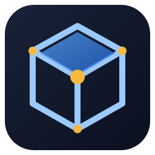
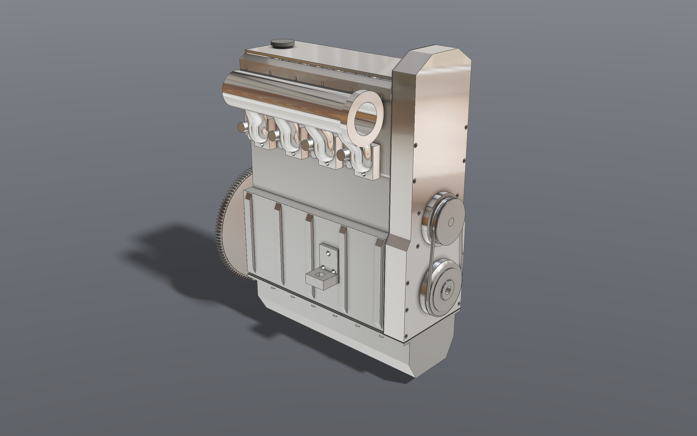
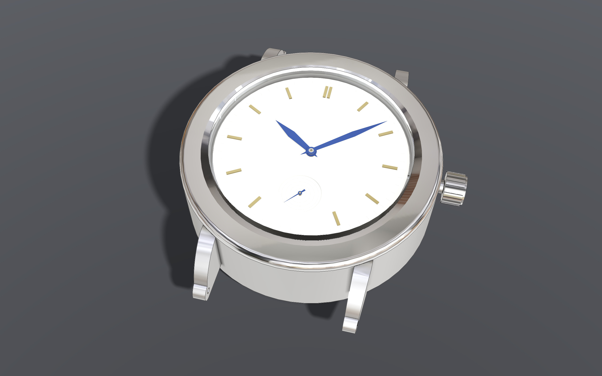
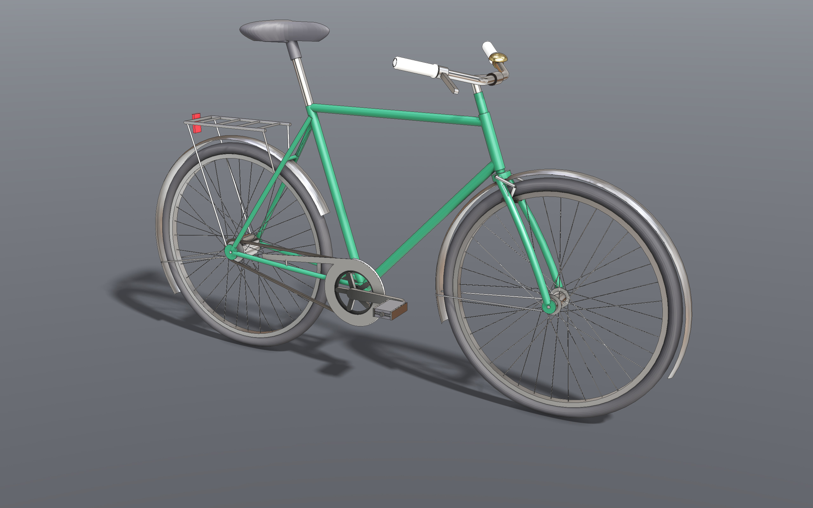
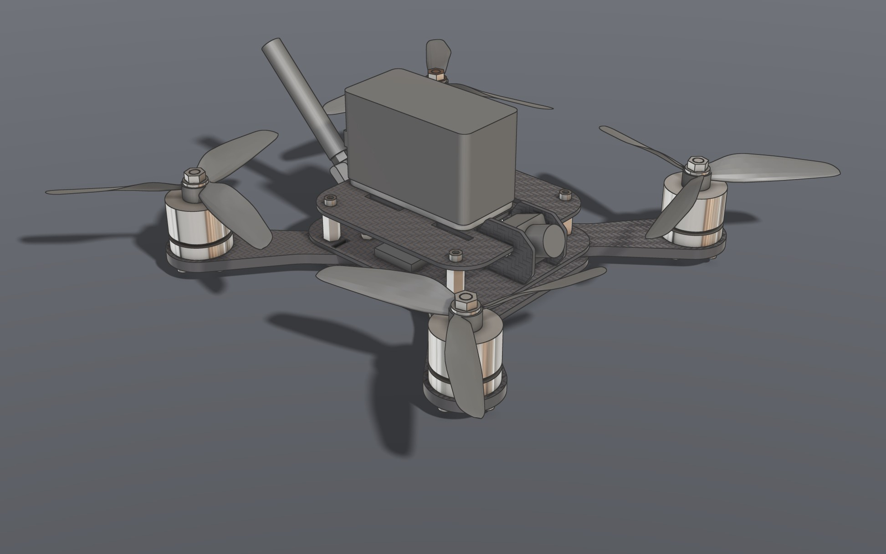

#  Loböle

[](https://github.com/eliasaronson/lobole/actions/workflows/ci.yml)

Open-source parametric CAD: B-Rep modeling on OpenCASCADE, a Vulkan
viewport, and one command layer that the GUI, Python scripts and AI agents
all drive. Linux first; Windows builds exist, macOS is untested.

Version 0.1: so expect some rough edges. Issues are welcome.

## What it does

- **Parametric modeling:** a constraint sketcher, features that survive
  upstream edits (stable topological naming), variables and expressions,
  configurations, sheet metal, bent tube.
- **Assemblies:** mates, sub-assemblies, motion studies with clash checks,
  exploded views, a BOM, standard fasteners.
- **Drawings:** sheets with projected views, dimensions and tables, out to
  SVG and PDF.
- **Simulation:** static and modal FEM, and topology optimization, on the
  part itself.
- **Manufacturing:** 2.5D, 3-axis and 4th-axis milling posted for Mach3,
  LinuxCNC or GRBL, each file verified by simulating it; checks for 3D
  printing.
- **Versioning:** history, named versions, branches and merges, backed by
  git.
- **Scripting and agents:** JSON-RPC, a Python SDK and an MCP server reach
  every command the GUI has; a terminal panel runs an agent inside the
  window.
- **Interchange:** STEP, IGES, STL, OBJ and BREP in, and DXF and SVG into a
  sketch; STEP, STL, BREP, glTF, OBJ, PLY, DXF, SVG and PDF out.

> [!WARNING]
> **CAM has cut real parts on one machine only**: a 6090 CNC router on
> Mach3. Simulate and dry-run every file before cutting.

https://github.com/user-attachments/assets/99e57644-9f8e-4515-8d65-cc3507e83352

## Gallery

Every model here is built by a generator, an ordinary Python program driving
the API; [generators/README.md](generators/README.md) lists them all.

| | |
|:---:|:---:|
| [](generators/om615) | [](generators/watch) |
| **OM615 diesel** (Opus 5.5): every part down to the bearing shells, with its injection pump chained to the crank and timed | **Automatic watch** (Opus 5, one shot): a 3 Hz self-winding movement, with lever escapement, rotor winding and keyless works |
| [](generators/bike) | [](generators/fpv_drone) |
| **Bicycle** (Opus 5.5, one shot): modelled from photographs | **5-inch FPV quadcopter** (Opus 5, one shot): 91 occurrences, fitted fasteners, FEM on the arms |

## Installing

From the [releases page](https://github.com/eliasaronson/lobole/releases):

- **Linux:** `lobole-<version>-x86_64.AppImage`, the full GUI on glibc
  2.39 or newer (Ubuntu 24.04, Debian 13, Fedora 40 and later). `chmod +x`
  it and run it; linked onto your PATH as `lobole`, the MCP server can
  start it by itself.
- **Ubuntu 26.04:** `sudo apt install ./lobole_<version>-1_amd64.deb`.
- **Windows:** a zip or an installer. Tested on Windows by hand and
  under Wine on every release, unsigned (SmartScreen warns), no FEM.
- **Linux, headless:** an AppImage with the engine and its JSON-RPC
  interface, no window, for servers ([caveats](docs/packaging/README.md#the-headless-appimage)).

Elsewhere:

- **Nix:** `nix run github:eliasaronson/lobole`, the full GUI. Outside
  NixOS the GUI needs [nixGL](https://github.com/nix-community/nixGL).
- **Container:** `ghcr.io/eliasaronson/lobole-headless`
  ([below](#container-headless)).
- **Python:** `pip install lobole`, the client, SDK and MCP server
  ([docs/scripting](docs/scripting/README.md)).

Other distributions: [build from source](#building).

## Requirements

**Ubuntu 24.04:** CI installs exactly this list on every push:

```
sudo apt install git cmake ninja-build build-essential python3 \
    libvulkan-dev glslc libglfw3-dev libglm-dev \
    libspdlog-dev libgtk-3-dev nlohmann-json3-dev libeigen3-dev libboost-dev \
    libocct-data-exchange-dev libocct-modeling-algorithms-dev libocct-modeling-data-dev \
    libocct-foundation-dev libocct-ocaf-dev libocct-visualization-dev \
    libtbb-dev libvterm-dev
```

**Ubuntu 26.04:** the same list, plus `libnglib-dev netgen python3-netgen
libspectra-dev` for FEM meshing and modal analysis; CI installs that too. The last two are needed only because
Ubuntu's Netgen CMake config checks for them.

**Nix / NixOS:** `nix-shell` in the repo root pins everything. The Vulkan
driver comes from your system (`hardware.graphics.enable = true`).

**Flatpak:** `tools/flatpak-build.sh` builds for any distribution
(`packaging/flatpak/`).

**Other distributions:** the Ubuntu list says what is needed; OpenCASCADE
must be 7.6 or newer, CMake 3.14+, and the compiler C++23.

**Windows** cross-compiles from Linux (`packaging/windows/`). **macOS** is
untested.

Clone with `--recurse-submodules` (or run `git submodule update --init
--recursive`) for the vendored dependencies.

### Optional parts

`cmake` prints which optional features it compiled in. CAM and the terminal
panel can be switched off (`-DENABLE_CAM=OFF`, `-DENABLE_TERMINAL=OFF`), and
then they do not exist at all. Without **Netgen** there is no FEM meshing,
and without **Spectra** no modal analysis; Ubuntu has both from 26.04 on,
and every release download except Windows carries them.
**CalculiX** (`ccx` 2.21 or later; `calculix-ccx` on Ubuntu and in Nix) is
a separate program found when a study asks for it, not a build dependency: a
static study can be solved on it as a second, independent answer
([docs/simulation](docs/simulation/README.md#calculix)). CI installs it on
both Ubuntu images.

On OpenCASCADE 7.6 (Ubuntu 24.04), PLY export is missing and some booleans
come out wrong ([details](docs/packaging/README.md#opencascade-76)).

## Building

```
cmake -S . -B build -G Ninja
cmake --build build
cmake --install build --prefix "$HOME/.local"   # optional: app, assets, desktop entry
```

### Without Dear ImGui Test Engine

The test engine is the one dependency that is not open source: a company
over 2M USD turnover that builds or ships Loböle needs a paid licence from
DISCO HELLO. `-DENABLE_TEST_ENGINE=OFF` removes it, along with the GUI test
suite and the remote `ui_action` tier.

## Running

```
build/lobole [-f path/to/file.step]
```

### Container (headless)

The engine and its JSON-RPC interface, no GPU or display, with the full
feature set (OpenCASCADE 7.9, Netgen, Spectra):

```
docker run --rm -p 8437:8437 ghcr.io/eliasaronson/lobole-headless
lobole-remote 8437 get_state          # from pip install lobole
```

`nix build .#dockerHeadless` builds the same image.

> [!CAUTION]
> The JSON-RPC interface is **unauthenticated and can read and write
> files**. The image listens on all interfaces so the published port works;
> never publish it on a network you do not trust.

## Testing

```
tools/ctest -LE gui -j$(nproc)    # headless: no GPU, no display
./tools/gui-tests-xvfb.sh         # the GUI suite on a virtual display
```

More in [CONTRIBUTING.md](CONTRIBUTING.md#running-the-tests).

## Remote control

**With an AI agent:** install the MCP server and register it, e.g. with
Claude Code. It attaches to a running Loböle, or starts one without a
window if none is running:

```
uv tool install lobole            # or: pip install lobole
claude mcp add lobole -- lobole-mcp
```

Scripts drive a live session over JSON-RPC (localhost only, opt-in):

```
./lobole --remote 8437     # or --headless --remote 8437, with no GPU
export PYTHONPATH=$PWD/python
python3 -m lobole.client 8437 get_state
python3 -m lobole.client 8437 add_feature \
    '{"feature": {"type": "Box", "name": "Box 1", "on": "Top",
                  "width": 2, "depth": 2, "height": 2}}'
```

Every GUI command is reachable, plus UI actions that click and type in the
real window. See the [Python SDK](docs/scripting/sdk.md) and the
[MCP server](docs/scripting/mcp.md).

## License

Copyright © Elias Högbom Aronsson

Loböle is licensed under the **GNU Affero General Public License, version 3
or any later version** ([`LICENSE`](LICENSE)). A distributed or
network-hosted derivative must be released under the AGPL with its source.
Files you make with Loböle (models, drawings, exports) are yours.

It comes **without any warranty**. Check simulation results before relying
on them for anything that carries load, and dry-run every G-code file.

### Linking Dear ImGui Test Engine

An additional permission under section 7 of the AGPL allows linking Loböle
with Dear ImGui Test Engine and conveying the result; the text is in
[`ADDITIONAL_PERMISSION.md`](ADDITIONAL_PERMISSION.md).

### Trademarks

Other products named here are trademarks of their owners; Loböle is not
affiliated with any of them. The name and logo of Loböle are **not licensed
under the AGPL**: a fork or modified build takes its own name
([`TRADEMARKS.md`](TRADEMARKS.md)).

### Third-party components

Listed with their licences, including the dynamically linked LGPL
libraries, in [`THIRD_PARTY.md`](THIRD_PARTY.md).
